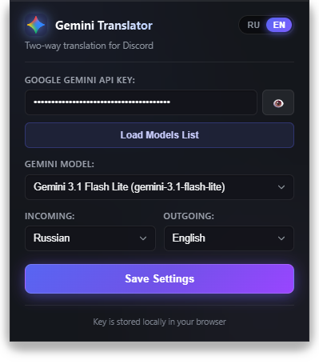

#  Discord Gemini Translator

<p align="center">
  <a href="README.md">English</a> | <strong>Русский</strong>
</p>

<p align="center">
  <a href="https://chromewebstore.google.com/detail/discord-gemini-translator/mdpenbnmpnopmmlhlgnkgjgmcinkbook"></a>
  <a href="https://developer.chrome.com/docs/extensions/develop"></a>
  <a href="https://ai.google.dev/"></a>
  <a href="#-тестирование"></a>
  <a href="LICENSE"></a>
</p>

<p align="center">
  Браузерное расширение для двустороннего мгновенного перевода сообщений в веб-версии <strong>Discord</strong> (<code>https://discord.com/*</code>) с использованием официального <strong>Google Gemini API</strong>.
</p>

<p align="center">
  
</p>

---

## ✨ Возможности

- 🎙️ **Синхронные субтитры голосовых каналов (Live Captions)**:
  - Прямой захват входящих аудиодорожек участников через WebRTC в реальном времени.
  - Потоковое распознавание и перевод через **Gemini Multimodal Live API** (WebSocket).
  - Встроенный локальный **VAD (Voice Activity Detection)**: отсекает тишину и шумы, отправляя аудио только при наличии речи для экономии бесплатных квот API.
  - Отдельный выбор модели для голосового перевода (Flash/Live) в настройках расширения.
  - Стильный перетаскиваемый оверлей субтитров с автозатуханием старых фраз через 7 секунд.
  - Кнопка быстрого включения/выключения `[🎙️ Субтитры]` прямо в голосовой панели и у поля ввода Discord.
- 📥 **Перевод входящих сообщений и автоопределение языка**:
  - Иконка перевода возле каждого сообщения в чате и цитатах ответов.
  - **Автоопределение языка**: плашка перевода наглядно показывает язык оригинала и направление (например, `⚡ Gemini (EN ➔ RU)` или `⚡ Gemini (JA ➔ RU)`).
  - **Умный пропуск родного языка**: сообщения, уже написанные на вашем языке, не переводятся впустую в авто-режиме, экономя квоты и не засоряя чат.
  - Аккуратная плашка с переводом прямо под сообщением, закрываемая в один клик.
- ⚡ **Режим автоперевода сообщений канала**:
  - Компактная кнопка `[⚡ Авто]` прямо в строке ввода Discord для текущего канала.
  - Глобальный тумблер в настройках для автоматического перевода всех каналов.
  - Умная очередь с троттлингом (350 мс) и пропуском старых архивных сообщений при входе.
- 📤 **Перевод исходящих сообщений (перед отправкой)**:
  - Кнопка Gemini рядом с полем ввода сообщений Discord.
  - Быстрая горячая клавиша: **`Ctrl + ~`** (тильда / `ё`) — переводит введённый текст на выбранный язык прямо в редакторе Discord Slate.
- 🌐 **Быстрая смена языка у поля ввода**:
  - Заметный бейдж `[ EN ▾ ]` прямо у кнопки ввода открывает всплывающее окно выбора из 9 языков без необходимости открывать popup.
- 🔍 **Обратный перевод для самопроверки (Reverse Preview)**:
  - Проверка смысла перед отправкой: плашка над полем ввода с обратным переводом (`RU ➔ EN ➔ RU`).
  - Кнопка **«Отменить»** в один клик восстанавливает исходный текст, если перевод исказил смысл.
  - Оптимизированный запрос получает оба перевода за один вызов Gemini, сохраняя 50% квот.
- 🎭 **Выбор тональности и стиля перевода**:
  - На выбор: **Геймерский / Сленг**, **Нейтральный (разговорный)**, **Официальный / Вежливый**, **Краткий (для коллов)**.
- ⚡ **Локальный LRU-кэш переводов**:
  - Мгновенный кэш до 500 последних фраз в `chrome.storage.local`.
  - Повторяющиеся фразы переводятся за 0 мс без расхода квот API.
- 🧠 **Поддержка актуальных моделей Google Gemini**:
  - Автоматическая загрузка списка доступных текстовых моделей по вашему API-ключу.
  - Поддержка **Gemini 2.5 Flash**, **Gemini 2.5 Flash-Lite**, **Gemini 2.5 Pro**, **Gemini 1.5 Flash/Pro**.
  - **Аппаратное отключение раздумий (`thinkingBudget = 0`)**: модели линейки 2.5 отвечают молниеносно (200–400 мс) без задержек и утечек рассуждений в текст.
- 🛡️ **Интеллектуальное сохранение синтаксиса Discord**:
  - Сохраняет разметку Markdown (`**жирный**`, `*курсив*`, `~~зачёркнутый~~`, `||спойлер||`, блоки кода `` ` `` и ```` ``` ````).
  - Сохраняет упоминания пользователей (`<@id>`), каналов (`<#id>`), ролей (`<@&id>`).
  - Сохраняет ссылки (URLs) и кастомные эмодзи сервера (`<:name:id>`).
- 🎨 **Современный стеклянный интерфейс (Glassmorphism & Neon)**:
  - Тёмная акриловая тема в стиле Discord & Gemini с мягким неоновым свечением.
  - Двуязычный интерфейс с мгновенным переключателем **`RU` / `EN`**.
- 🔒 **Конфиденциальность и безопасность**:
  - API-ключ хранится **строго локально** в вашем браузере (`chrome.storage.local`) и передаётся напрямую только на официальный сервер Google Gemini (`generativelanguage.googleapis.com`).

---

## 🚀 Установка

Поскольку расширение не требует сборки и написано на чистом JavaScript (Manifest V3), его можно установить за 1 минуту:

1. **Скачайте репозиторий**:
   - Нажмите зелёную кнопку **Code** ➔ **Download ZIP** и распакуйте архив в удобную папку на компьютере (или клонируйте через `git clone`).
2. **Откройте страницу расширений**:
   - В браузере (Google Chrome, Microsoft Edge, Brave, Яндекс.Браузер, Opera) перейдите по адресу:
     ```text
     chrome://extensions
     ```
3. **Включите режим разработчика**:
   - В правом верхнем углу переключите тумблер **«Режим разработчика»** (*Developer mode*).
4. **Загрузите расширение**:
   - Нажмите кнопку **«Загрузить распакованное расширение»** (*Load unpacked*) в левом верхнем углу.
   - Выберите папку с проектом `discord-gemini-translator`.
5. **Готово!** Расширение появится на панели инструментов браузера.

---

## ⚙️ Настройка

1. Получите бесплатный API-ключ на [Google AI Studio](https://aistudio.google.com/app/apikey).
2. Нажмите на иконку расширения **Gemini Translator** на панели браузера.
3. Вставьте ваш ключ в поле **API-ключ Google Gemini**.
4. Нажмите кнопку **«Загрузить список моделей»** и выберите модель (рекомендуется **Gemini 2.5 Flash-Lite** или **Gemini 2.5 Flash**).
5. Настройте языки для входящих и исходящих сообщений.
6. Нажмите **«Сохранить настройки»**.

---

## ⌨️ Горячие клавиши

| Сочетание клавиш | Действие |
| :--- | :--- |
| **`Ctrl + ~`** (или `Ctrl + ё`) | Перевести написанный текст в поле ввода Discord на целевой язык исходящих |

---

## 📁 Структура проекта

```text
discord-gemini-translator/
├── manifest.json                  # Манифест расширения Manifest V3
├── GEMINI.md                      # Обязательный регламент разработки для AI-агентов
├── assets/                        # Скриншоты и графические промо-материалы
│   └── settings.png               # Превью окна настроек
├── icons/                         # Иконки расширения (16x16, 48x48, 128x128 px и SVG)
├── popup/                         # Окно настроек расширения
│   ├── popup.html                 # Разметка с акриловой шапкой и i18n атрибутами
│   ├── popup.css                  # Стили Glassmorphism со свечениями
│   └── popup.js                   # Локализация RU/EN, загрузка моделей, сохранение
├── background/                    # Фоновый сервис-воркер
│   └── background.js              # REST v1beta + WebSocket Gemini Multimodal Live API
├── content/                       # Скрипты взаимодействия с Discord
│   ├── content.js                 # Инъекция UI, чат-наблюдатель и оверлей субтитров (ISOLATED)
│   ├── content.css                # Scoped-стили кнопок и блоков перевода (.dgt-*)
│   └── inject.js                  # Захват WebRTC звука, VAD, PCM 16kHz & Slate.js (MAIN)
└── tests/                         # Набор автоматических тестов (Node.js test runner)
    ├── i18n-no-hardcode.test.js   # Защита от хардкода строк интерфейса и чистота словарей
    ├── live-captions.test.js      # Протокол WebSocket Live API и сборка предложений
    ├── inject-audio.test.js       # Аудиоконвертер, VAD и даунсэмплинг PCM 16kHz
    ├── background.test.js         # Service Worker, REST-запросы, LRU-кэш и ошибки
    ├── content.test.js            # Интеграция с чатом, замена Slate и селекторы
    └── popup.test.js              # Валидация настроек и фильтрация моделей
```

---

## 🧪 Тестирование

Проект покрыт полным набором автоматических тестов на нативном тестовом фреймворке Node.js (`node:test` + `node:assert/strict`) **без тяжелых сторонних npm-зависимостей**:

```bash
npm test
```

### Что проверяют 88 тестов:
- 🌐 **Защита от хардкода интерфейса (`i18n-no-hardcode.test.js`)**: гарантирует наличие атрибутов `data-i18n` у всех элементов интерфейса, полное соответствие словарей RU/EN, отсутствие кириллицы в английской локали и блокирует прямое присвоение строк в свойства DOM (`textContent`, `title`, `alert`).
- 🎙️ **Потоковые Live-субтитры (`live-captions.test.js`)**: проверяет WebSocket-сообщения Gemini Multimodal Live API, приоритет транскрипций, фильтрацию скрытых мыслей модели (`thought: true`) и фиксацию реплик по флагу `turnComplete`.
- 🔊 **Захват звука и VAD (`inject-audio.test.js`)**: тестирует даунсэмплинг WebRTC аудиопотока из 48 кГц в 16 кГц, расчёт порога громкости RMS для отсечения тишины и упаковку в Base64 PCM 16-bit.
- ⚡ **Фоновые сервисы и кэш (`background.test.js`)**: проверяет REST-запросы, отключение бюджета рассуждений `thinkingBudget: 0`, работу LRU-кэша и фильтрацию моделей.
- 💬 **Интеграция с Discord DOM (`content.test.js`)**: проверяет подстановку текста через Slate.js, очереди автоперевода и работу контекстных плашек.
- ⚙️ **Окно настроек (`popup.test.js`)**: проверяет разделение текстовых и голосовых моделей, синхронизацию настроек и сохранение API-ключа.

---

## 📋 Регламент разработки

Для разработчиков и AI-агентов создан строгий регламент разработки: [[GEMINI.md](GEMINI.md)]. В нём зафиксированы обязательные правила: архитектурные стандарты, предотвращение регрессий, изоляция стилей `dgt-*` и чеклист перед сдачей задач.

---

## 📄 Лицензия

Проект распространяется под свободной лицензией [MIT](LICENSE).
